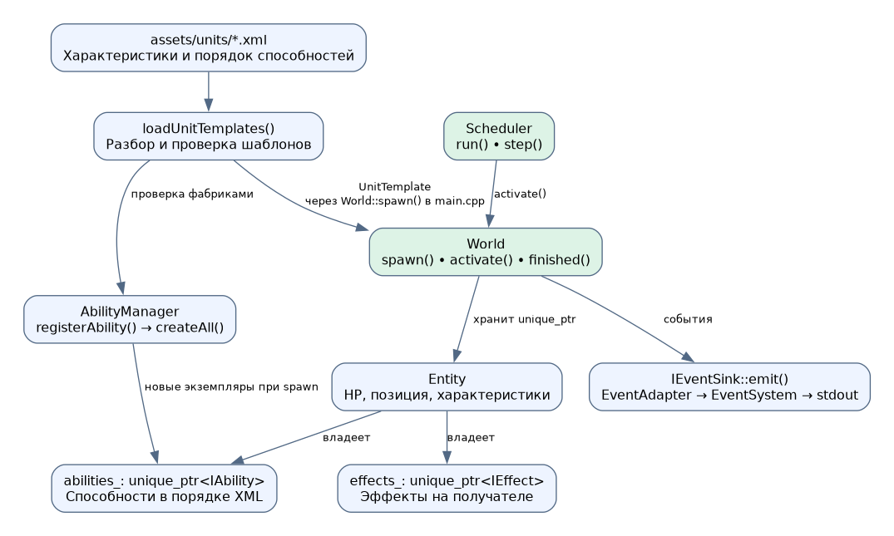

# Как устроена боевая симуляция

В основе симуляции четыре компонента:

- **Мир (`World`)** хранит юнитов и управляет очередью их активаций.
- **Способность (`IAbility`)** проверяет условия и предлагает действие: например, атаковать доступную цель.
- **Действие (`IAction`)** выполняет выбранную операцию: перемещает юнита, наносит урон или накладывает эффект.
- **Эффект (`IEffect`)** остаётся на юните после действия: например, яд наносит урон при следующих активациях получателя.

Маршрут чтения:

1. Этот документ — объекты, хранение данных и основные методы.
2. [Цепочки вызовов](03_EXECUTION_FLOW.md) — кто выбирает способность, выполняет действие и вызывает эффект.
3. [Добавление юнита и атаки](04_EXTENSION_GUIDE.md) — XML, C++ и регистрация фабрики.
4. [Правила механик](02_RULES.md) и [сборка](05_BUILD_AND_TEST.md).

## 1. Слои и данные

[Исходник диаграммы DOT](diagrams/architecture.dot).

| Часть | Ответственность | Куда смотреть |
| --- | --- | --- |
| Приложение | Соединяет зависимости, регистрирует обработчики команд, запускает симуляцию | [main.cpp](../src/main.cpp) |
| IO | Читает сценарий и XML; не реализует правила боя | [CommandParser](../src/IO/System/CommandParser.cpp), [UnitLoader](../src/IO/Config/UnitLoader.cpp) |
| Core | Хранит юнитов, выбирает следующую активацию, применяет перемещение, урон и эффекты | [World](../src/Core/World.hpp) и его `.cpp`-файлы |
| Features | Реализует атаки, движение, яд и раны через интерфейсы Core | [каталог Features](../src/Features/README.md) |
| Вывод | Переводит `Event` в исходный текстовый протокол | [EventAdapter](../src/App/EventAdapter.hpp) |

**Активация** — очередь одного живого юнита. **Раунд** — обход очереди юнитов.
`World::tick()` считает активации, а не раунды. Эффекты на юните считают активации
своего получателя; это ещё одна, отдельная шкала времени.

### World и Entity

`World::entities_` содержит `std::unique_ptr<Entity>`. Объект `Entity` содержит:

- `id`, `type`, `position`, `hp`, характеристики `properties` и назначенный маршрут `march`
- `footprint` и `targetProfile` для геометрии, занятости и доступности для атак
- приватный `abilities_`: `std::vector<std::unique_ptr<IAbility>>`
- приватный `effects_`: `std::vector<std::unique_ptr<IEffect>>`

`abilities_` сохраняет порядок шаблона. `effects_` сохраняет порядок добавления.
Эффект яда лежит **на отравленном юните**, а не на охотнике. ID охотника хранится
в `IEffect::source`, чтобы засчитывать ему урон, в том числе после его смерти.

`World::entity(id)` возвращает `const Entity&`. Погибший юнит остаётся в хранилище,
но перестаёт действовать и занимать клетки. Его ID нельзя использовать повторно.
Его эффекты удаляются после завершения текущей операции.

### Способность, действие и эффект — разные объекты

| Объект | Зачем нужен | Когда создаётся и удаляется |
| --- | --- | --- |
| `IAbility` | Проверяет возможность работы и предлагает действие | Фабрика создаёт отдельный экземпляр для юнита; живёт вместе с `Entity` |
| `ActivationContext` | Передаёт мир, действующего юнита, RNG и кеш целей | `World::activate()` создаёт на одну активацию; ссылки на него нельзя сохранять |
| `AbilityProposal` | Возвращает `NotApplicable` либо `Ready` и действие | Создаётся при `propose()`; после обработки результата уничтожается |
| `IAction` | Хранит параметры выбранного действия и применяет изменения | Способность создаёт для конкретной активации; `unique_ptr` в результате удаляет его после обработки |
| `IEffect` | Выполняет отложенную работу или изменяет входящий урон | Действие создаёт и передаёт миру; хранится на цели до истечения срока или её смерти |

Например: `PoisonArrowsAbility` выбирает цель → `PoisonArrowsAction` накладывает яд →
`PoisonEffect` наносит порции урона при следующих активациях цели.

## 2. От XML до созданного юнита

1. До `main()` статические регистраторы Features вызывают
   `AbilityManager::instance()->registerAbility(key, factory)`.
2. `main()` вызывает `validateAndFreeze()`. При ошибках регистрации запуск прекращается.
3. `loadUnitTemplates(sw::app::unitsXml)` читает встроенные XML. Загрузчик проверяет
   структуру и вызывает `AbilityManager::createAll()` для проверки параметров фабриками.
   Это временные экземпляры способностей, а не будущие объекты живых юнитов.
4. Обработчик команды вызывает `World::spawn(id, position, template, overrides)`.
5. `spawn()` объединяет базовые характеристики и шаблон через `resolveUnitProperties()`,
   затем применяет overrides. `hp` переносится в отдельное поле `Entity::hp`.
6. `createAll()` повторно вызывает фабрики с окончательными характеристиками, сохраняет
   порядок и проверяет пары через `validateCompatibility()` в обоих направлениях.
7. World сохраняет юнита и публикует `Spawned`.

`AbilityConfig::implementation` — ключ фабрики, например `attack`.
`AbilityConfig::name` — необязательная метка для диагностики. Она не выбирает C++-класс,
не задаёт имя эффекта и не определяет автоматически имя события способности.

В XML два разных набора свойств: свойства **юнита** и параметры **способности**.
`damageStat="strength"` — строковое имя характеристики юнита, а не значение урона.
Фабрика проверяет эту ссылку; `AttackAbility` читает указанную характеристику при работе.

## 3. Основные методы и их вызывающий код

| Метод | Кто и когда вызывает | Результат / обязанность |
| --- | --- | --- |
| `World::createMap()` | Обработчик команды создания карты | Устанавливает размеры и публикует событие |
| `World::spawn()` | Обработчик команды или тест | Создаёт юнита и способности из шаблона |
| `World::march()` | Обработчик команды марша | Назначает цель марша. Если юнит уже в точке, сразу публикует `MARCH_ENDED`. Иначе перемещение делает способность `move` |
| `Scheduler::run()` | Приложение после чтения сценария | Выполняет активации до завершения, цикла или лимита |
| `Scheduler::step()` | Обычно тест или пошаговый инструмент | Выполняет одну активацию без проверки `finished()` и без детектора циклов |
| `World::finished()` | `Scheduler::run()` перед очередной активацией | Проверяет наличие работы через `canAct()` и `hasPendingWork()` |
| `World::activate()` | `Scheduler::run()` / `Scheduler::step()` | Обрабатывает эффекты, затем выбирает первое готовое действие |
| `World::unitCount()` / `World::unitAt()` | `Scheduler` | Дают число юнитов и ID юнита по порядку создания |
| `World::snapshot()` | `Scheduler::run()` | Кодирует состояние мира для поиска цикла |
| `World::takeCycleBlockedFlag()` | `Scheduler::run()` | Возвращает и сбрасывает признак эффекта, мешающего поиску цикла |
| `IAbility::canAct()` | `finished()` для живых юнитов | Чистая проверка возможной полезной работы; без RNG и изменения состояния |
| `IAbility::propose()` | `World::activate()` в порядке шаблона | Самостоятельно проверяет условия, делает выбор и возвращает действие либо отказ |
| `ActivationContext::chooseTarget()` | `propose()` атаки | Выбирает цель через RNG или возвращает кеш группы |
| `IAction::execute(World&)` | `World::activate()` для первого `Ready` | Меняет мир через `damage()`, `applyEffect()`, `moveAlong()` и другие операции |
| `World::applyEffect()` | Действие или другой эффект | Сохраняет новый эффект на цели либо обновляет длительность существующего |
| `IEffect::onApply()` | `applyEffect()` после вставки нового экземпляра | Выполняет немедленную часть эффекта; при обновлении не вызывается |
| `IEffect::onActivation()` | `activateEffects()` перед способностью цели | Выполняет очередную порцию работы эффекта |
| `IEffect::modifyDamage()` | `damage()` для активных эффектов получателя | Преобразует входящий урон без изменения мира |
| `World::endOperation()` | Код, открывший операцию | На внешнем уровне удаляет эффекты и публикует накопленный урон, затем смерти |
| `IEventSink::emit()` | World при публикации события | Передаёт событие адаптеру вывода синхронно |

Подробный порядок и примеры — в [цепочках вызовов](03_EXECUTION_FLOW.md).

## 4. Границы текущей реализации

`IAction::execute()` и callbacks эффектов получают настоящий `World&`. Поэтому
технически им доступны и создание карты, и `spawn()`. Планировщик им недоступен:
`Scheduler` живёт отдельно от `World`, и `World` о нём не знает.
**Узкого `IActionContext` сейчас нет.**

Существующий контракт требует менять состояние через операции мира. Исключения не откатывают изменения; после сбоя
callback симуляцию нельзя считать пригодной для продолжения. Возможный будущий
рефакторинг — отдельный интерфейс разрешённых операций для действий.

**Эффектов области, включая огненную стену, сейчас нет.** `IEffect` всегда связан с
одной целью и её активациями. Для стены нужно отдельно определить хранение клеток,
фазу нанесения урона и единицу длительности, затем добавить соответствующую поддержку
в Core. «Пять ходов» нельзя без решения подменять пятью активациями мага или пятью
раундами. Смерть мага и получение урона большим юнитом тоже требуют явных правил.

## 5. Навигация по реализации

Правила файлов в Core:

- Один публичный класс — это два файла: `ClassName.hpp` и `ClassName.cpp`.
- Вспомогательные функции, которые использует только один `.cpp`, лежат в нём в анонимном `namespace`.
- Мелкие значимые типы, перечисления и чистые интерфейсы можно собрать в один тематический заголовок,
  например `Damage.hpp`, `Effects.hpp`, `Events.hpp`, `Targeting.hpp`.

- [Scheduler.cpp](../src/Core/Scheduler.cpp) — очередь активаций, остановка и поиск циклов.
- [World.cpp](../src/Core/World.cpp) — состояние мира, активация юнита, выбор способности, снимок состояния.
  Здесь же урон, эффекты, события и поиск целей.
- [ActivationContext.cpp](../src/Core/ActivationContext.cpp) — выбор и кеширование цели в одной активации.
- [AttackAbility.cpp](../src/Features/Attacks/AttackAbility.cpp) — общая логика атак и шанса.
- [AbilityManager.cpp](../src/Core/AbilityManager.cpp) — фабрики способностей и совместимость.
- [Pathfinder.cpp](../src/Core/Pathfinder.cpp) — путь в обход занятых клеток. Проверку занятости даёт `World`.
- [MtRandom.cpp](../src/Core/MtRandom.cpp) — генератор случайных чисел за интерфейсом `IRandom`.

Комментарии Doxygen в заголовках описывают контракт конкретного метода.
Это руководство объясняет, как эти методы соединяются в работающую симуляцию.
