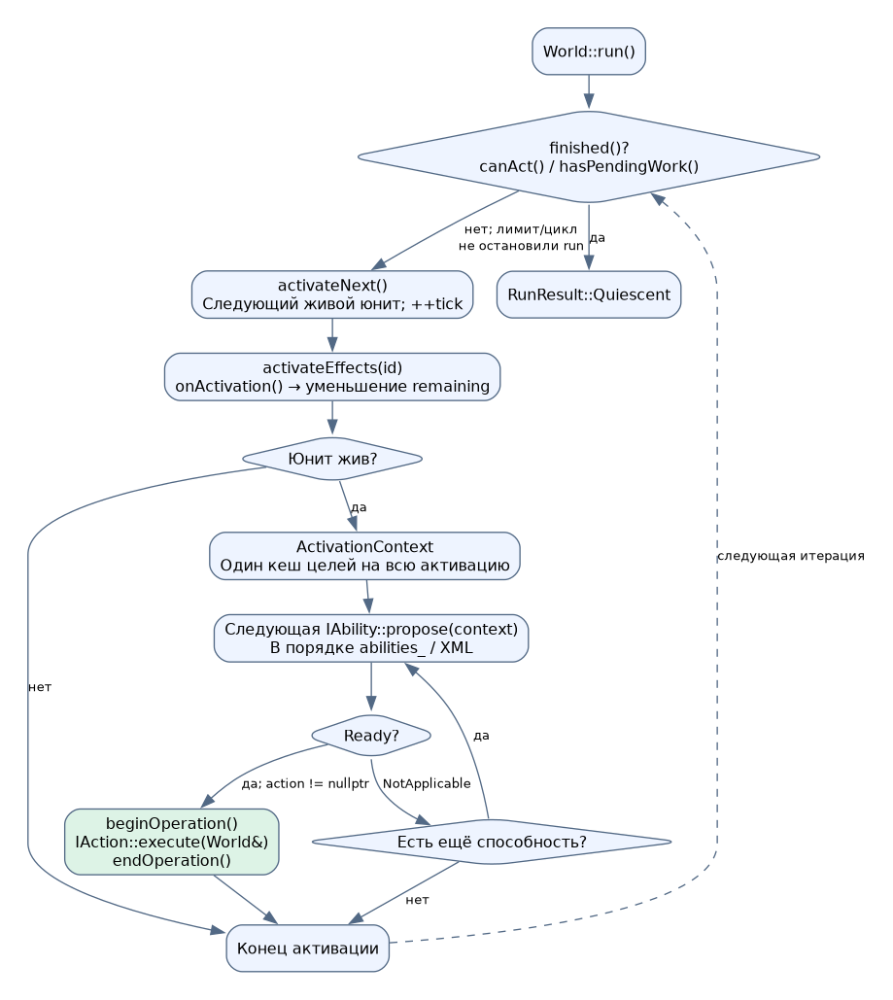
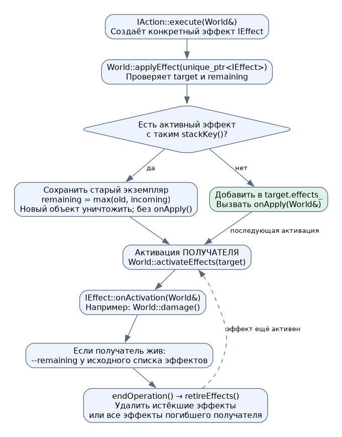

# Кто кого вызывает: способность → действие → эффект

[Обзор архитектуры](01_ARCHITECTURE.md) · [Добавление механики](04_EXTENSION_GUIDE.md)

## 1. Кто выбирает способность

Очередь ведёт класс `Scheduler`
([Scheduler.hpp](../src/Core/Scheduler.hpp), [Scheduler.cpp](../src/Core/Scheduler.cpp)).
`Scheduler::run()` и `Scheduler::step()` выбирают следующего живого юнита в порядке
создания и просят `World` активировать его через `World::activate()`.
**Выбор юнита** и **выбор его способности** — два разных шага.
Первый делает `Scheduler`, второй — `World`.

После обработки эффектов `World::activate()` перебирает `Entity::abilities_`.
Этот вектор собран в порядке `<ability>` из XML. Планировщик не знает, что такое
«яд», «меч» или «движение»: он понимает только `NotApplicable` и `Ready`.



[DOT](diagrams/activation.dot). На схеме показан обычный путь `Scheduler::run()`; проверки
лимита и доказанного цикла могут завершить его до очередной активации.

Сокращённый код выбора, соответствующий реализации:

```cpp
ActivationContext context{*this, unit.id, random, {}};
for (const auto& ability : unit.abilities_)
{
    auto proposal = ability->propose(context);
    if (proposal.status == AbilityProposal::Status::NotApplicable)
    {
        continue;
    }
    if (!proposal.action)
    {
        throw std::logic_error("Ready ability omitted its action");
    }
    beginOperation();
    proposal.action->execute(*this);
    endOperation();
    return;
}
```

Выполняется не более одного действия за активацию. Если отказали все способности,
действия не будет, но активация уже произошла и `tick` увеличился.

### Пример мечника

В [swordsman.xml](../assets/units/swordsman.xml) порядок такой:

1. `rending`: ищет цель, проверяет шанс и при успехе предлагает специальную атаку.
2. `attack`: если предыдущая способность отказала, предлагает обычную атаку.
3. `move`: если атаки отказали, ищет путь к назначенному `march`-назначению.

`move` не означает «найти врага и подойти». Без команды марша или доступного пути
движение не предложит действие. Если атака готова, она занимает активацию, даже
если у юнита одновременно есть маршрут.

### Почему есть и canAct(), и propose()

| Вопрос | `canAct()` | `propose()` |
| --- | --- | --- |
| Кто вызывает? | `World::finished()` | `World::activate()` |
| Для чего? | Понять, можно ли завершить симуляцию | Выбрать конкретное действие сейчас |
| Можно использовать RNG? | Нет | Да, через `context.random` |
| Можно менять мир? | Нет | Нет; изменения выполняет возвращённый `IAction` |
| Что возвращает? | Возможность полезной работы | Действие или отказ |

**`canAct()` не вызывается как обязательная проверка перед `propose()`.**
Более того, `Scheduler::step()` вообще не вызывает `finished()`. Поэтому `propose()` обязан
сам проверить необходимые условия. Ненулевой шанс атаки означает возможную работу
для `canAct()`, но конкретный бросок в `propose()` может завершиться отказом.

## 2. Кто выбирает цель и как работает шанс

Для стандартных атак это делает `AttackAbility::propose()`:

1. Читает характеристики атакующего и проверяет допустимость величины урона.
2. Вызывает `context.chooseTarget(query, targetGroup)`.
3. Если есть цель, проверяет дополнительные условия и, когда настроен шанс,
   сравнивает `context.random.uniform(1, 1000)` со значением характеристики шанса.
4. При успехе вызывает виртуальный `makeAction(source, target, amount)` конкретной атаки.
5. Возвращает `Ready` с полученным действием.

`World::targets()` только собирает подходящие ID и сортирует их. Случайный выбор
из этого списка выполняет `ActivationContext::chooseTarget()`.

Непустой `targetGroup` сохраняет первый результат в контексте активации. Кешируется
и отсутствие цели. Повторный вызов той же группы **не проверяет новый запрос** и
не расходует RNG. Пустая группа означает независимый выбор при каждом вызове.

Поэтому мечник при неудачном броске ран атакует обычным ударом ту же выбранную цель.
`AttackAbility::validateCompatibility()` заранее отклоняет несовместимые настройки
атак одной группы. Для собственного наследника `IAbility` такую проверку нужно
реализовать самому, если он разделяет группу с другими способностями.

## 3. Кто добавляет эффект

**Да, это делает `Action::execute()`, вызывая метод мира.** Способность только
подготавливает действие. Пример из [PoisonArrows.cpp](../src/Features/Attacks/PoisonArrows.cpp):

```cpp
void execute(core::World& world) override
{
    world.abilityUsed(source_, abilityName);
    world.applyEffect(
        std::make_unique<PoisonEffect>(source_, target_, totalDamage_));
}
```

Здесь действие создаёт конкретный C++-объект и отдаёт его `World::applyEffect()`.
Оно не получает доступ к `Entity::effects_`, не вызывает будущие активации эффекта
и не удаляет эффект вручную.



[DOT](diagrams/effect.dot).

`applyEffect()` выполняет следующие шаги:

1. Отбрасывает `nullptr`, неположительный `remaining` и неизвестного или мёртвого получателя.
2. Получает `stackKey()` нового эффекта и ищет активный эффект с равным ключом на цели.
3. При совпадении оставляет **старый экземпляр**, устанавливает
   `remaining = max(old.remaining, incoming.remaining)` и уничтожает новый объект.
   Сила и внутреннее состояние старого эффекта сохраняются. `onApply()` не вызывается.
4. Без совпадения добавляет объект в `target.effects_`, затем вызывает `onApply()`.

По умолчанию ключ — `{type, target, std::nullopt}`: источники объединяются.
Яд переопределяет его как `{type, target, source}`: каждый охотник держит свой
экземпляр яда на получателе.

## 4. Кто вызывает эффект позже

Перед каждой активацией юнита `World::activate()` вызывает `activateEffects(unit.id)`.
Он сохраняет список эффектов с `remaining > 0`, существующих в начале обработки,
и внутри операции вызывает у них `onActivation(World&)` в порядке добавления.

Если эффект убивает получателя, цикл останавливается и способность юнита уже не
вызывается. Если получатель выжил, после callbacks уменьшаются таймеры исходного
списка. Благодаря этому один эффект видит другой ещё активным в пределах этой
обработки, даже если его срок закончится сейчас.

Эффект, добавленный из callback, может получить `onApply()` немедленно, но в
текущий список `onActivation()` не попадёт. Его периодическая обработка начнётся
со следующей активации получателя.

`endOperation()` на внешнем уровне вызывает `retireEffects()`: удаляет эффекты с
истёкшим сроком, а у мёртвых юнитов очищает список целиком. Отложенное удаление
нужно, чтобы не уничтожить объект во время выполнения его собственного callback.

### Пример: Poison = 12

При первом наложении `PoisonEffect::onApply()` наносит 3 урона и сам уменьшает
`remaining` с 5 до 4. При четырёх следующих активациях получателя `onActivation()`
наносит 3, 2, 2, 2 урона. После каждого такого вызова таймер уменьшает уже World.
Без модификаторов и при достаточном HP сумма равна 12.

Немедленный урон и ручное уменьшение в `onApply()` — **особенность PoisonEffect**,
а не автоматическое поведение всех эффектов. Новый эффект может ничего не делать
в `onApply()` и начать наносить урон со следующей активации цели.

Обновление яда тем же источником не повторяет мгновенную порцию. Оно продлевает
старый экземпляр до пяти будущих активаций, сохраняя его силу и текущую фазу порций.

## 5. Как эффект изменяет урон и откуда берутся события

Любой урон проходит через `World::damage(DamageRequest)`:

1. Проверяется получатель и исходная величина урона.
2. У активных эффектов **получателя** вызывается `modifyDamage(request, amount)`.
   Каждый следующий получает результат предыдущего; `request` остаётся исходным.
3. Итог ограничивается диапазоном `[0, target.hp]`; HP уменьшается сразу.
4. Фактический урон добавляется к записи пары `source/target` текущей операции.
5. При нулевом HP цель помечается для события смерти и теряет маршрут.
6. При завершении внешней операции публикуются накопленные `Attacked`, затем `Died`.

У ран `RendingEffect::modifyDamage()` удваивает запросы с тегом `poison`. Сам World
не знает правил яда и ран: теги интерпретирует Feature.

Операция — группа вложенных вызовов, а не транзакция с откатом. `World::activate()` уже
оборачивает `execute()` в `beginOperation()` / `endOperation()`. Вложенный
`damage()` или `applyEffect()` не публикует смерть раньше завершения внешней операции.
Обработка эффектов перед действием — отдельная операция, поэтому весь ход не
обязательно даёт одно общее событие урона. `abilityUsed()` публикуется сразу.

`World::emit()` ставит текущий `tick` и вызывает `IEventSink::emit()`. Далее
`EventAdapter::emit()` переводит событие в DTO, а `EventSystem::event()` пишет строку
в stdout. Feature не должна печатать боевой протокол самостоятельно.

## 6. Когда бой заканчивается

`finished()` ищет полезную работу у всех живых юнитов. Учитывается либо `canAct()`
способности, либо активный эффект с `hasPendingWork() == true`. Поэтому яд может
продолжать бой после смерти источника. Пассивная метка ран возвращает `false` и
сама бой не продлевает: её срок может остаться ненулевым при завершении симуляции.

`Scheduler::run()` также умеет возвращать `Cycle` при доказанном повторе состояния и
`ActivationLimit` при исчерпании бюджета. Для новой механики безопасно оставить
`cycleState() == std::nullopt`: бой сохраняет проверку обычного завершения и лимит,
но доказательство цикла для такого состояния недоступно. Пустая строка — обещание,
что частного изменяемого состояния нет, а не универсальная заглушка.
