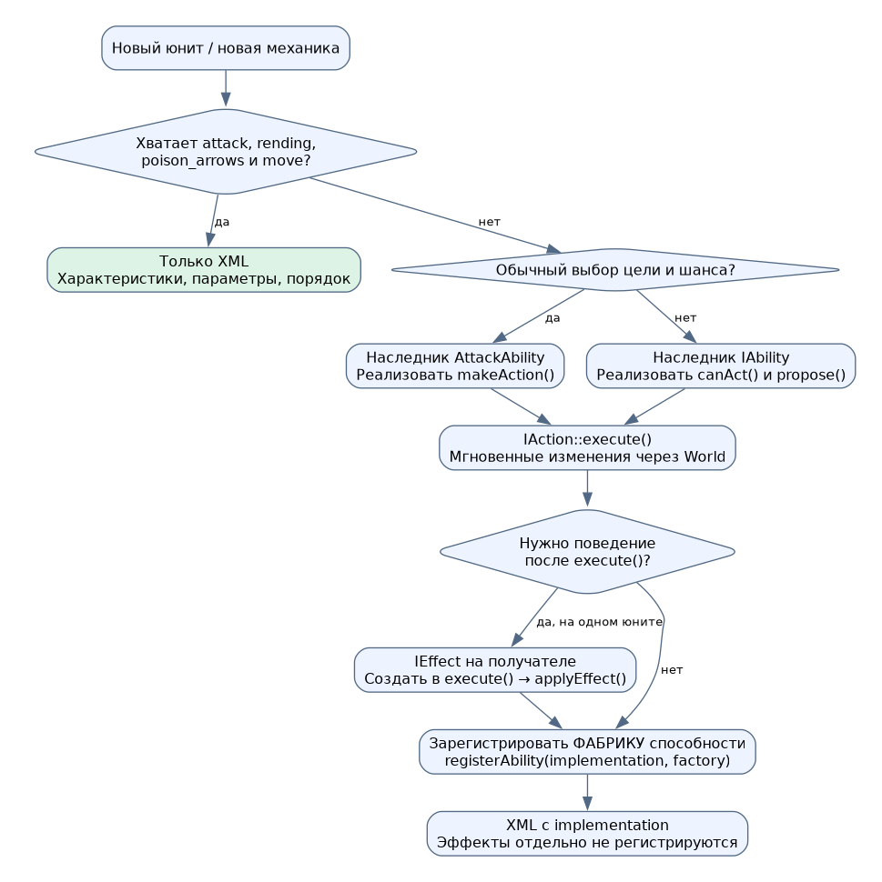

# Как добавить юнита и собственную атаку

[Обзор](01_ARCHITECTURE.md) · [Порядок вызовов](03_EXECUTION_FLOW.md) · [Сборка](05_BUILD_AND_TEST.md)

## 1. Сначала выбери объём изменения



[DOT](diagrams/extension.dot).

| Что нужно | Что менять |
| --- | --- |
| Другие HP, сила, дальность, шанс существующей спецатаки | XML-шаблон |
| Другой порядок существующих атак, несколько их экземпляров, скорость движения | XML-шаблон |
| Новая характеристика, которую читает существующая атака через `damageStat` | XML: объявить характеристику и сослаться на неё |
| Новый мгновенный результат атаки, например два разных запроса урона | C++: действие и способность/наследник `AttackAbility`, затем XML |
| Поведение после действия: периодический урон или временный модификатор входящего урона | C++: `IEffect`, действие, которое его накладывает, и фабрика способности |
| Другая логика выбора действия, не укладывающаяся в стандартную атаку | C++: собственный `IAbility` с `canAct()` и `propose()` |
| Область на карте, например огненная стена | Сначала расширение Core: текущий `IEffect` привязан к одному юниту |

XML выбирает и настраивает существующие реализации. Он не описывает произвольный
алгоритм и не создаёт новые callbacks. Простое добавление свойства `armor` ничего
не изменит, пока какая-либо механика его не читает.

## 2. Вариант без C++: новый страж

Готовый шаблон: [guard.xml](examples/guard.xml). Скопируй его в `assets/units/guard.xml`:

```xml
<unit name="guard">
    <properties>
        <property name="hp" type="int" value="30"/>
        <property name="strength" type="int" value="4"/>
    </properties>
    <abilities>
        <ability implementation="attack" name="melee">
            <properties>
                <property name="kind" type="string" value="melee"/>
                <property name="damageStat" type="string" value="strength"/>
            </properties>
        </ability>
        <ability implementation="move"/>
    </abilities>
</unit>
```

Страж сначала пытается атаковать соседнюю цель с силой 4. Если цели нет, пытается
продолжить назначенный марш. По умолчанию у `attack` дальность 1–1, у `move` — одна
клетка за активацию. Само наличие `move` не назначает маршрут.

После добавления файла пересобери проект. CMake встраивает `assets/units/*.xml` в
`UnitsXml.hpp`; при запуске приложение не ищет эти файлы на диске.

В тесте или своём инструменте, где созданы `World` и карта:

```cpp
const auto templates = sw::io::loadUnitTemplates(sw::app::unitsXml);
world.spawn(1, {0, 0}, templates.at("guard"));
world.march(1, {4, 0}); // Только если требуется движение к этой точке.
```

Этот фрагмент требует заголовки `IO/Config/UnitLoader.hpp`, `Core/World.hpp` и
сгенерированный `UnitsXml.hpp`. Реализации Features должны быть подключены к бинарнику,
иначе их фабрик не будет в реестре. Перед загрузкой шаблонов приложение проверяет
`AbilityManager::instance()->validateAndFreeze()`.

**Новый XML не добавляет команду сценария.** Публичный CLI знает только
`SPAWN_SWORDSMAN` и `SPAWN_HUNTER`. Не добавляй `SPAWN_GUARD` ради теста: это изменит
заданный протокол. Создавай новый тип через `World::spawn()` в тесте/инструменте.

### Какие параметры уже доступны

| `implementation` | Обязательные параметры способности | Что выполняет |
| --- | --- | --- |
| `attack` | `kind`, `damageStat` | Обычный урон, без броска шанса |
| `rending` | `kind`, `damageStat`, `chanceStat` | Урон и метка ран на выжившей цели |
| `poison_arrows` | `kind`, `totalDamageStat`, `chanceStat` | Яд: величина означает сумму базовых пяти порций |
| `move` | Нет; необязательный `cells` | Шаги по назначенному маршруту |

Для атак общие параметры: `minRange`, `maxRange` **или** `maxRangeStat`,
`noAdjacent`, `targetGroup`. `kind` — `melee` или `ranged`.
`chanceStat` ссылается на целое число 0–1000, а не на проценты 0–100.
Типы XML: `int`, `double`, `bool`, `string`; автоматического преобразования между ними нет.

Порядок способностей — приоритет. Общий `targetGroup` нужен, если специальная и
обычная атака должны использовать одну цель при отказе спецатаки. Параметры запросов
внутри группы должны совпадать; `AttackAbility` проверяет это при создании.

`name` — метка диагностики, `implementation` — ключ фабрики. Это разные поля.
Длительность и правила яда/ран зашиты в C++: произвольный параметр `duration` в их
XML будет отклонён. Геометрия и слой существуют в `UnitTemplate`, но текущий
XML-загрузчик не предоставляет секций для их настройки; не придумывай неизвестные теги.

## 3. Вариант с C++: атака, которая поджигает цель

Полный пример: [BurningAttack.cpp](examples/BurningAttack.cpp) и [ember.xml](examples/ember.xml).
Это учебные файлы в `docs/examples`: они **не подключены к игровому бинарнику**.
Для добавления механики скопируй `.cpp` в `src/Features/Attacks/`, а XML — в `assets/units/`.
CMake подхватит новый Feature-файл при сборке. Не копируй один регистратор дважды:
дубликат ключа не даст приложению запуститься.

Правило примера: ближняя атака без вероятностного броска накладывает горение.
Оно наносит `burn_damage` урона на каждой из трёх следующих активаций цели.
Мгновенного урона нет. Разные источники поддерживают отдельные эффекты; тот же
источник продлевает старый эффект до трёх оставшихся активаций без изменения силы.
Это горение на одном юните, **не огненная стена**.

### Шаг A. Эффект хранит состояние и выполняет отложенную работу

В `BurningEffect` конструктор передаёт `IEffect("burning", source, target, 3)` и
сохраняет урон. `onActivation()` делает только запрос:

```cpp
world.damage({source, target, damage_, {"fire"}});
```

Таймер после `onActivation()` уменьшает World. Не уменьшай его второй раз.
`onApply()` не переопределён, поэтому немедленного урона нет.

`stackKey()` возвращает `{type, target, source}`. Если убрать `source`, все источники
одного типа начнут обновлять общий экземпляр. Если требуется суммировать силу или
заменять старую силу новой, стандартное обновление `applyEffect()` этого не делает:
нужно отдельно проектировать такое правило, а не ждать его от ключа.

`hasPendingWork()` по умолчанию возвращает `true`, что подходит периодическому урону.
Для чисто пассивного модификатора переопредели его в `false`, иначе эффект будет
продлевать симуляцию сам по себе. Для реакции на входящий урон переопредели
`modifyDamage()`; он должен вернуть число без изменения мира.

### Шаг B. Действие накладывает эффект

`BurningAction` хранит ID источника, ID цели и величину урона. `World::activate()` вызывает
его `execute()` только после выбора `Ready`:

```cpp
world.abilityUsed(source_, "burning_attack");
world.applyEffect(std::make_unique<BurningEffect>(source_, target_, damage_));
```

Первый вызов публикует факт использования способности, второй передаёт эффект миру.
Само действие не меняет `effects_`, не вызывает будущие `onActivation()` и не удаляет
эффект вручную. Операцию для действия уже открывает и закрывает `World::activate()`.

### Шаг C. Способность использует общий алгоритм атаки

`BurningAttack` наследуется от `AttackAbility`, потому что ей подходят стандартные
правила дальности и выбора цели. Она переопределяет только
`makeAction(source, target, amount)` и создаёт `BurningAction`.

`AttackAbility::propose()` сам проверяет условия, выбирает цель и вызывает
`makeAction()`. Если нужен вероятностный бросок, передай `true` четвёртым аргументом
в `readAttackConfig()` фабрики и добавь `chanceStat` в XML. У нашего примера броска нет.

Если стандартный алгоритм не подходит, наследуйся от `IAbility` напрямую:

- `canAct(world, actor)` проверяет возможность полезной работы без изменений и RNG
- `propose(context)` повторно проверяет необходимые условия, принимает решения и
  возвращает `{Ready, action}` либо пустой результат `{}`
- `validateCompatibility(other)` проверяет ограничения совместного использования,
  если они есть. Реестр вызывает метод для каждой пары в обе стороны

`canAct()` не является предварительным фильтром для `propose()`. Подробное объяснение
и фактический цикл планировщика — [здесь](03_EXECUTION_FLOW.md#1-кто-выбирает-способность).

### Шаг D. Регистрируется способность, а не эффект

В примере статический `Registrar` вызывает:

```cpp
core::AbilityManager::instance()->registerAbility(
    "burning_attack",
    [](const core::AbilityConfig& config, const core::PropertyMap& unitProperties)
    {
        AbilityProperties properties(config.properties);
        auto attack = readAttackConfig(properties, unitProperties, "damageStat");
        properties.rejectUnknown();
        return std::make_unique<BurningAttack>(std::move(attack));
    });
```

Ключ `burning_attack` должен совпадать с XML `implementation="burning_attack"`.
`readAttackConfig()` проверяет ссылки на характеристики, диапазоны и параметры
выбора цели. `rejectUnknown()` ловит опечатки и неподдерживаемые параметры.

Фабрика вызывается при проверке XML и при каждом `spawn()` после overrides.
Она должна возвращать новый ненулевой экземпляр, не менять мир и не сохранять
ссылки на временные аргументы. Для своих параметров используй
`AbilityProperties::required<T>()`, `optional<T>()` и `inRange()`.

**Реестра эффектов и метода `registerEffect()` в проекте нет.** `BurningEffect`
создаётся обычным `std::make_unique` внутри действия. Строка `"burning"` — тип для
ключа и `hasEffect()`, а не зарегистрированное имя фабрики. Аналогично действия не
регистрируются: их создаёт способность. Таким образом, связь явная:

`XML implementation → фабрика BurningAttack → makeAction() → BurningAction → execute() → BurningEffect`.

### Шаг E. Настрой юнита

В [ember.xml](examples/ember.xml) у юнита объявлены `hp=20` и `burn_damage=2`.
Способность использует `damageStat="burn_damage"`. `kind="melee"` с обычными
значениями дальности даёт атаку на соседнюю клетку. У этого учебного юнита только
одна способность: без цели он не двигается. При необходимости добавь `move` последним.

## 4. Что проверить перед сдачей

Для XML-юнита достаточно проверить успешную загрузку, ожидаемый урон, приоритет
способностей и марш. Для новой атаки с эффектом добавь проверки поведения:

- После активации атакующего эффект появился **на цели**, а источник записан верно.
- Для нашего примера HP не меняется в момент наложения; урон начинается с активации цели.
- Три активации цели дают три порции, после третьей эффект удаляется.
- Повтор того же источника обновляет длительность, не меняя силу и не добавляя экземпляр.
- Два источника создают два экземпляра, а события сохраняют правильные ID источников.
- Смерть источника не удаляет горение; смерть получателя удаляет его эффекты.
- Отсутствие цели возвращает отказ, чтобы следующая способность могла сработать.
- Некорректная ссылка на характеристику, неверный тип и неизвестный параметр дают ошибку.

Для пошаговой проверки используй `scheduler.step()` (`Scheduler` создаётся рядом с `World`), `world.entity(id).hp`,
`effectCount()` и `effect(index)`. Учитывай очередь: один `Scheduler::step()` — один живой юнит,
а не полный раунд. Для проверки событий передай миру тестовый `IEventSink`.

Не возвращай пустую строку из `cycleState()` автоматически. В примере оставлен
безопасный стандартный `std::nullopt`: контракт доказательства циклов не заявлен.
Сначала добейся корректности механики, затем отдельно описывай её состояние для детектора.

```sh
cmake -S . -B build
cmake --build build
cmake --build build --target check-format
ctest --test-dir build --output-on-failure
```

Цель `check-format` появляется, если clang-format найден при конфигурации CMake.
